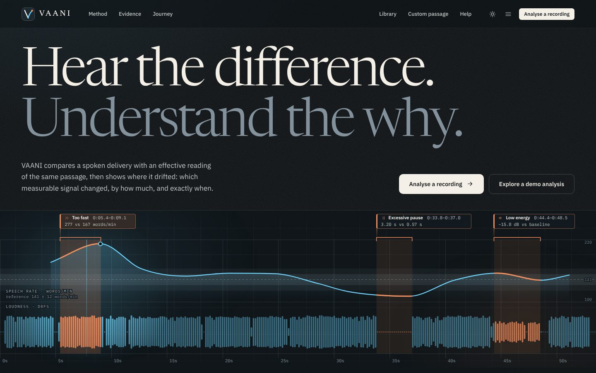
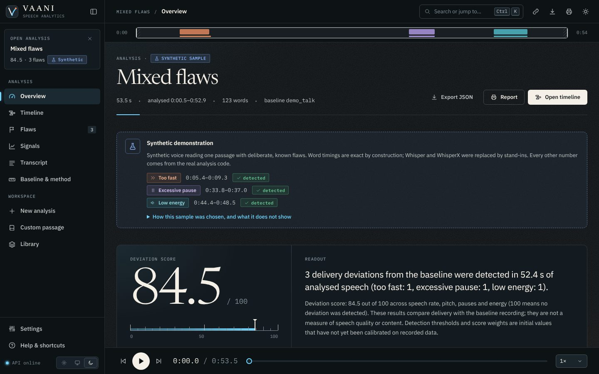
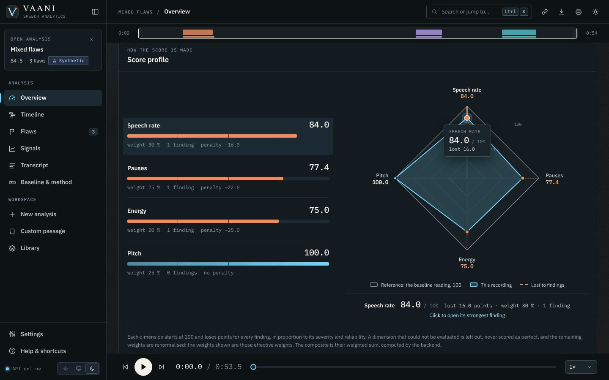
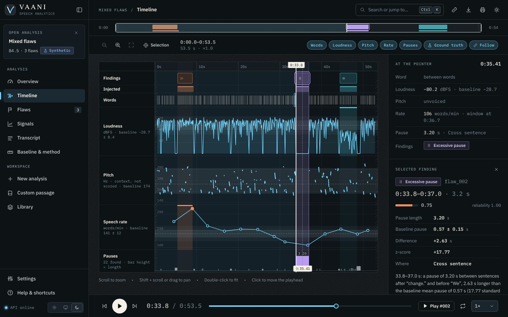
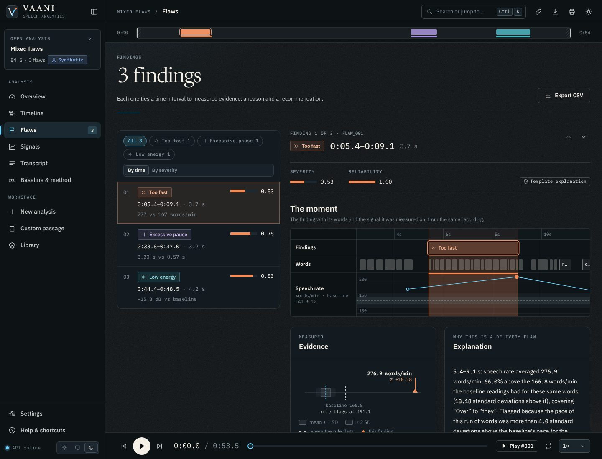
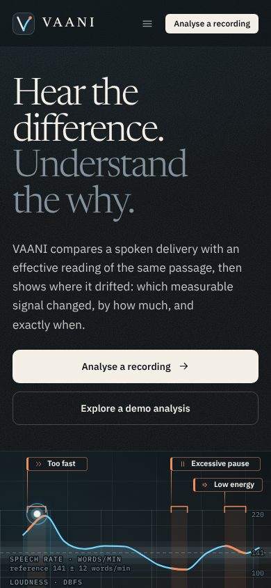
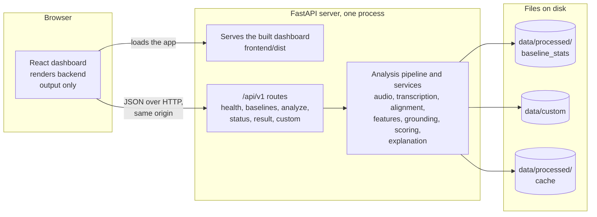

<div align="center">

# 🎙️ VAANI

### Contrastive speech analytics with temporal flaw grounding

**Hear the difference. Understand the why.**


[Quick start](#quick-start) · [How it works](#how-it-works) · [Tech stack](#tech-stack) · [API](#api-reference) · [Evaluation](#evaluation) · [Documentation](#documentation)



</div>

> [!IMPORTANT]
> **Read this first: what VAANI is, and what it is not**
>
> - VAANI judges **delivery** (pace, pauses, loudness, pitch movement) against a baseline reading of the *same text*. It does not judge what was said, how well it is written, or whether it is true.
> - It is an **evidence tool, not a verdict.** Detection thresholds and score weights are *initial values that have not been calibrated* (`THRESHOLDS_CALIBRATED=false`). Every result says so in its `notes`, and a score such as 84.5 is not yet a calibrated measure of quality.
> - **What has been measured so far** is small: the team's own 85+ recordings (three speakers, two passages).
> - The four **demo analyses are synthetic**: a speech-synthesiser voice reads one passage with deliberate flaws, and the app labels them as such. Their numbers come from the real analysis code, but Whisper and WhisperX were replaced by exact-timing stand-ins when they were made.
> - **No LLM (large language model) runs anywhere.** Explanations are templates filled from measured evidence, and a separate guard rejects any sentence that contains a number that is not in that evidence.

## Contents

[Overview](#overview) · [Features](#features) · [Screenshots](#screenshots) · [How it works](#how-it-works) · [Flaw types](#flaw-types) · [Tech stack](#tech-stack) · [Project structure](#project-structure) · [Quick start](#quick-start) · [Using the dashboard](#using-the-dashboard) · [Configuration](#configuration) · [API reference](#api-reference) · [Running the tests](#running-the-tests) · [Evaluation](#evaluation) · [Recording your own dataset](#recording-your-own-dataset) · [Documentation](#documentation) · [Engineering rules](#engineering-rules) · [Limitations and roadmap](#limitations-and-roadmap) · [AI-assisted development](#ai-assisted-development) · [Privacy and consent](#privacy-and-consent) · [Acknowledgements and licence](#acknowledgements-and-licence)

## Overview

**VAANI** (वाणी, "speech, voice") compares a spoken delivery with an *effective reading of the same passage* and answers six questions about it:

1. **Where** did the delivery drift from the reference?
2. **Which** measurable signal changed: pace, pauses, loudness, pitch movement?
3. **How much**, in the signal's own units (words per minute, seconds, dB, Hz)?
4. **When**: from which word to which word, in seconds?
5. **Why** is that a delivery flaw, in terms of the evidence?
6. **What** should the speaker do about it?

A recording goes in. What comes out is a short list of **findings**, each tied to a time interval, to the measurements that support it and to a recommendation, plus a 0–100 score that is nothing more than the arithmetic of those findings.

| Principle | What it means here |
|---|---|
| **Contrast, not an average** | The reference is a good reading of the *same* text, not a universal human average. The comparison runs word by word, so a naturally long word or an expected pause is not mistaken for a flaw. |
| **Grounded in time** | A flaw without an interval is incomplete. Every finding has a start and an end, on word boundaries wherever possible. |
| **Evidence before explanation** | Every sentence the user reads is built from structured evidence. A number that is not in the evidence cannot appear. |
| **Deterministic** | The same audio, baseline and configuration give the same findings, the same score and the same `analysis_id`. |
| **Honest by construction** | Anything not judged, not calibrated or thinly supported is stated in the result's `notes`, never silently filled in. |
| **The backend owns the truth** | The dashboard only draws what the API returns. It computes no pitch, rate, severity or score. |

## Features

**Dashboard** (React, dark by default, light on request)

- **Home page** with a live instrument that draws the real analysis of a demo recording: hover to read any moment, click a labelled interval to hear it.
- **New analysis**: upload a WAV or MP3 or record in the browser, pick a baseline, analyse.
- **Custom passage**: paste your own text, add two to six recordings of a good reading to make a baseline, then analyse your own reading against it.
- **Overview** (score, score profile radar, readout), **Timeline** (every signal on one zoomable time axis, linked to playback), **Flaws** (evidence, explanation and recommendation for each finding; CSV export), **Signals**, **Transcript**, **Baseline and method**, and a **printable report**.
- **Library** of the demo samples and your analyses (kept in your browser), settings, help, a command palette (`Ctrl+K`), keyboard shortcuts, light and dark themes.

**API** (FastAPI, documented, versioned as contract 1.3.0)

- Upload a recording, get the full structured `AnalysisResult`: features, flaws with evidence, scores, notes. Results are cached under a deterministic id and can be fetched again.

**Dataset and evaluation kit** (for the team's own recordings)

- A deterministic recording plan with an on-screen prompter, a recording quality checker, a registration tool that aligns and annotates takes, and an evaluation tool that replays takes through the analysis and compares the findings with the plan.

## Screenshots

> All screenshots show the built-in **synthetic demo samples** (a speech-synthesiser voice, deliberate flaws). They illustrate the interface; they are not a measurement of accuracy.

<p align="center">
  <a href="docs/demo/screenshots/overview.jpg"></a><br>
  <b>Overview</b>: the score, and a plain-language readout of the findings behind it
</p>

<p align="center">
  <a href="docs/demo/screenshots/profile.jpg"></a><br>
  <b>Score profile</b>: each dimension against the reference ring of 100, and what the findings cost
</p>

<p align="center">
  <a href="docs/demo/screenshots/timeline.jpg"></a><br>
  <b>Timeline</b>: every signal on one time axis, linked to playback; hover reads any moment
</p>

<p align="center">
  <a href="docs/demo/screenshots/finding.jpg"></a><br>
  <b>A finding</b>: interval, severity, the words it covers, measured evidence and explanation
</p>

<p align="center">
  <a href="docs/demo/screenshots/landing-phone.jpg"></a><br>
  <b>Phone width</b>: the same instrument, with shorter labels
</p>

## How it works

### The pipeline


| # | Stage | What happens | Code |
|---|---|---|---|
| 1 | **Preprocessing** | Decodes WAV or MP3, mixes to mono, resamples to 16 kHz, scales loudness so typical speech sits at −26 dBFS (peak capped at −1 dBFS), trims leading and trailing silence and remembers the offset so every timestamp refers to the original file. Limits: 10 MB and 5 minutes. | `services/audio/` |
| 2 | **Transcription** | Whisper (`base` model, English) turns the speech into text. A `manual_transcript` can be supplied instead. | `services/transcription/` |
| 3 | **Forced alignment** | WhisperX gives every word a start and an end time; implausible alignments are rejected. | `services/alignment/` |
| 4 | **Feature extraction** | Pitch (pYIN F0, 75–500 Hz), 13 MFCCs, energy (RMS in dBFS), speech rate (rolling 8 s windows every 4 s), and pauses (energy voice-activity detection plus gaps between aligned words), all on a 10 ms grid. | `services/features/` |
| 5 | **Baseline normalisation** | Expresses the participant's measurements relative to the baseline's statistics (z-scores). | `services/grounding/normalizer.py` |
| 6 | **Contrastive comparison** | Judges pace, loudness and pitch movement *word by word* against how the baseline readers read the same words (see below). | `services/grounding/profile*.py` |
| 7 | **Flaw detection and grounding** | Turns deviations into candidate findings with a start, an end and a type. | `services/grounding/candidates.py`, `flaws.py` |
| 8 | **Severity** | A number from 0 to 1 from the *size* of the change and how long it lasted. | `services/grounding/severity.py` |
| 9 | **Scoring** | Deterministic arithmetic over the findings (see below). | `services/scoring/` |
| 10 | **Explanation** | Fills a template from the finding's evidence and checks every number with an independent guard. | `services/explanation/` |
| 11 | **API response** | One typed `AnalysisResult`, cached under a deterministic id. | `schemas/`, `core/cache.py` |
| 12 | **Dashboard** | Draws the result and plays the audio. | `frontend/` |

Orchestration lives in `backend/app/services/pipeline.py`.

### The baseline and the word profile

A single average pace for a whole passage cannot tell a rushed sentence from a sentence that is simply full of short words. So the baseline keeps, **for every word of the passage**, how long it took, how loud it was and how much the pitch moved on it in each good reading, and how much those readings differ from one another. A new reading is compared with that, word by word:

- A **pace or loudness finding** is a run of at least 10 consecutive words that is far outside the natural variation (z above 4) **and** practically different (at least 15 % in pace or 3 dB in level), after the reading's own overall pace and level have been taken out. A reading that is fast, slow, loud or quiet *as a whole* becomes one finding covering the whole reading.
- A **flat-pitch finding** is a run of at least 10 words (or the whole reading) with clearly less pitch movement than the baseline readers had on the same words (at least 35 % less, z below −4.5).
- An **excessive pause** is a pause of at least 1.2 s that is also more than 2 (inside a sentence) or 2.5 (between sentences) baseline standard deviations longer than the baseline's pauses at that kind of place.
- With **fewer than three baseline readings** there is no word profile. VAANI then falls back to coarser overall rules and says so in the result's `notes`.

Every one of these limits is a named setting (see [Configuration](#configuration)), and every one is still an uncalibrated starting value.

### Severity and score

- **Severity** (0–1) is the size of the change measured against a documented "most serious" size for that flaw type (twice or half the baseline pace, 15 dB, 3.5 s of extra pause, a third of the baseline's pitch movement), multiplied by how long the deviation lasted relative to 5 s (a pause's severity depends on its excess length only).
- **Score:** each finding costs its dimension `30 × severity × reliability` points (reliability is currently the constant 1.0). A dimension starts at 100. The overall score is the weighted sum of the four dimensions: **speech rate 30 %, pitch 25 %, pauses 25 %, energy 20 %**. A dimension that could not be judged is **left out and the other weights are renormalised**; it is never scored as a perfect 100. **100 means "no deviation detected".**

Worked example, the *Mixed flaws* demo (three findings, one in each of three dimensions):

| Dimension | Findings | Penalty | Score | Weight |
|---|---|---|---|---|
| Speech rate | 1 (too fast, severity 0.5343) | 30 × 0.5343 = 16.03 | 83.97 | 30 % |
| Pitch | 0 | 0 | 100.00 | 25 % |
| Pauses | 1 | 22.58 | 77.42 | 25 % |
| Energy | 1 | 25.04 | 74.96 | 20 % |

Overall: `0.30 × 83.97 + 0.25 × 100.00 + 0.25 × 77.42 + 0.20 × 74.96 = 84.54`.

### Explanations and the number guard

The explanation of a finding is a **template filled from its structured evidence** (`explanation_method: "template"`). Before it is shown, an independent guard (`services/explanation/guard.py`) checks that every numeric token equals a value in the finding's fact sheet and rejects spelled-out quantities such as "twice" or "half". An explanation layer that cannot invent a number is what lets every figure on screen be traced back to a measurement. `EXPLANATION_PROVIDER` only accepts `template`; an LLM provider is not implemented.

### A finding, end to end

A real finding from the *Mixed flaws* demo, trimmed (`low_confidence`, `warnings`, two evidence fields and most of `affected_words` omitted):

```jsonc
{
  "flaw_id": "flaw_001",
  "type": "too_fast",
  "start_s": 5.3996,
  "end_s": 9.0548,
  "duration_s": 3.6552,
  "severity": 0.5343,
  "reliability": 1.0,
  "evidence": {
    "rate_participant_wpm": 276.9105,
    "rate_baseline_mean_wpm": 166.8481,
    "rate_baseline_std_wpm": 6.0538,
    "rate_delta_wpm": 110.0625,
    "rate_delta_pct": 65.9657,
    "rate_z_score": 18.1808,
    "word_count_in_window": 17
  },
  "explanation": "5.4–9.1 s: speech rate averaged 276.9 words/min, 66.0% above the 166.8 words/min the baseline readings had for these same words (18.18 standard deviations above it), covering “Over” to “they”. Flagged because the pace of this run of words was more than 4.0 standard deviations above the baseline's pace for the same words over at least 0.5 s, which indicates accelerated delivery compared with the baseline.",
  "recommendation": "Slow down in this stretch: aim for about 166.8 words/min, the pace the baseline readings had for these words, and keep the pauses between phrases.",
  "explanation_method": "template",
  "rule": { "feature": "rate_run_z", "direction": "above", "threshold_z": 4.0, "min_duration_s": 0.5 },
  "affected_words": ["Over", "the", "past", "year", "…", "they"]
}
```

The chain is always the same: **timestamp → measured evidence → flaw type → explanation → recommendation.**

### Reproducibility

The `analysis_id` is a UUID derived from a SHA-256 of everything the result depends on: the preprocessed audio, the baseline, the passage, any manual transcript, the configuration, the pipeline and API versions, a fingerprint of every analytical constant, and the library versions. Same request, same id, same stored result; change a threshold and the id changes, so a stale result is never served. Randomness plays no part in any number the user sees.

<details>
<summary><b>Terms used</b></summary>

| Term | Meaning |
|---|---|
| **Baseline** | Statistics (and a word profile) built from good readings of the same passage. The reference for every comparison. |
| **Word profile** | For each word of the passage: how long it took, how loud it was and how much the pitch moved, in the baseline readings, plus how much those readings vary. |
| **z-score** | How many "natural spreads" a measurement is from the baseline's average. Larger means less likely to be ordinary variation. |
| **Forced alignment** | Matching known text to audio to get a start and end time for every word. |
| **F0** | Fundamental frequency, i.e. the pitch of the voice, in Hz. |
| **MFCC** | Mel-frequency cepstral coefficients, a compact description of the spectral shape of the voice. Extracted and shown, but not used by any finding or score yet. |
| **dBFS** | Loudness relative to the loudest level a digital recording can hold (0 dBFS). |
| **Severity / reliability** | How serious a deviation is (0–1) / how much to trust it. Reliability is currently the constant 1.0. |

</details>

## Flaw types

| Type | What it means | Measured evidence | Status |
|---|---|---|---|
| `too_fast` | A run of words spoken faster than the baseline readers spoke the same words | rate, baseline rate and spread, difference in words/min and %, z-score, word count | detected |
| `too_slow` | The same, slower | same fields | detected |
| `excessive_pause` | A pause far longer than the baseline's pauses at that kind of place | pause length, baseline mean and spread, difference in s, z-score, where (inside or between sentences) | detected |
| `low_energy` | Words spoken quieter than the baseline readers spoke them | level, baseline level and spread, difference in dB, z-score | detected |
| `high_energy` | The same, louder | same fields | detected |
| `flat_pitch` | Clearly less pitch movement than the baseline readers had on the same words | movement in Hz against the baseline's, z-score, voiced share, the words | detected (checked on synthetic speech only) |
| `pitch_instability` | Unsteady pitch | none yet | planned, **not detected** |
| `reduced_clarity` | Reduced vocal clarity | none yet | planned, **not detected** |

New flaw categories are not added casually: a new one needs measurable evidence, a detection rule, temporal grounding, a scoring policy, an explanation policy, tests and team approval ([`AGENTS.md`](AGENTS.md) §5).

## Tech stack

| Layer | Technology | Used for |
|---|---|---|
| **API** | Python 3.10–3.13, **FastAPI**, **Uvicorn**, **Pydantic v2**, python-multipart, python-dotenv | Typed contract, uploads, settings, serving the built dashboard |
| **Audio** | **PyAV** (`av`), NumPy, SciPy | WAV and MP3 decoding (no ffmpeg needed), polyphase resampling, numerics |
| **Acoustic features** | **librosa** | pYIN F0, MFCC, RMS energy |
| **Speech models** | **OpenAI Whisper** (`openai-whisper`), **WhisperX** (+ PyTorch) | Transcription and forced word alignment |
| **Analysis** | Plain, deterministic Python | Word profile, detection, severity, scoring, template explanations, number guard |
| **Dashboard** | **React 19**, **TypeScript 5.9**, **Vite 7** | Single-page app with hash routing and small external stores |
| **Charts** | Hand-built **SVG**, no chart or UI library | Radar, timeline lanes, live instrument |
| **Design** | One token-based design system (VAANI): obsidian and graphite surfaces, ivory type, cyan for signal, copper for deviation, steel for the reference; IBM Plex Sans and Mono, Newsreader (self-hosted through Fontsource) | Light and dark themes, reduced-motion support |
| **Storage** | JSON files on disk, no database | Result cache, baseline statistics, custom passages |
| **Tests** | **pytest**; **Vitest**, Testing Library, jsdom; **axe-core**; **Playwright** (Chromium) scripts | Unit, API, end-to-end, accessibility and browser checks |
| **Types** | **openapi-typescript** | The dashboard's API types are generated from the API's own OpenAPI document |

Not used: a database, Docker, ffmpeg, an external LLM or any API key, a chart library, a UI framework, third-party analytics.



## Project structure

```text
speechdummy/
├── README.md                        this file
├── AGENTS.md                        the project constitution: rules for people and AI agents
├── ARCHITECTURE.md                  the canonical design (pipeline, schemas, scoring, evaluation plan)
├── DECISIONS.md                     every design decision with its reason (DEC-001 and on)
├── TASKS.md                         task list
├── PROJECT_STATE.md                 what works, what is blocked, known risks, next priorities
├── requirements.txt                 Python dependencies
├── pytest.ini                       test configuration (real-model "smoke" tests are opt-in)
├── .env.example                     every setting with its default (optional)
│
├── backend/
│   ├── app/
│   │   ├── main.py                  FastAPI app: /api/v1 routes, and the built dashboard at /
│   │   ├── api/                     routes (analyze, results, catalog, custom, health), error responses
│   │   ├── core/                    settings, baseline records, passages, result cache
│   │   ├── schemas/                 the API contract (Pydantic models)
│   │   └── services/
│   │       ├── audio/               decoding, resampling, speech-level scaling, silence trim
│   │       ├── transcription/       Whisper
│   │       ├── alignment/           WhisperX and alignment validation
│   │       ├── features/            F0, MFCC, energy, speech rate, pauses
│   │       ├── grounding/           normalisation, word profile, flaw detection, severity
│   │       ├── scoring/             the deterministic score
│   │       ├── explanation/         fact sheet, templates, number guard, summary
│   │       ├── pipeline.py          orchestrates the stages
│   │       ├── baseline_builder.py  builds baseline statistics from recordings
│   │       └── custom.py            custom passages
│   └── tests/                       backend unit and API tests
│
├── frontend/                        the dashboard (React + TypeScript + Vite)
│   ├── src/                         app shell, pages (features/), charts, state, API client, styles
│   ├── public/samples/              the four synthetic demo analyses and their audio
│   ├── tests/                       dashboard tests
│   └── scripts/                     screenshots, accessibility audit, browser smoke test
│
├── scripts/
│   ├── check_environment.py         checks this computer, downloads the speech models once
│   ├── export_openapi.py            writes (or checks) the OpenAPI snapshot behind the dashboard types
│   ├── demo/                        builds the synthetic demo samples
│   └── dataset/                     recording plan, quality checker, registration, baselines, evaluation
│
├── data/                            dataset metadata, recording plan, baselines (no recordings)
├── docs/                            setup, API contract, architecture, methodology, submission
└── tests/                           integration and end-to-end tests
```

## Quick start

### What you need

| Tool | Version | Needed for |
|---|---|---|
| **Git** | any recent | getting the code |
| **Node.js** (with npm) | 20.19 or newer | the dashboard (Options A and B) |
| **Python** | 3.10 to 3.13 | the API and the analysis (Options B, C and D) |
| **Disk and internet** | several GB | PyTorch (pulled in by Whisper and WhisperX) and, on the first real analysis, the speech models |

No ffmpeg, no database, no Docker and no API keys are needed.

```bash
git clone https://github.com/rubella2121/speechdummy.git
cd speechdummy
```

### Option A: look at the demo (about 2 minutes, no Python)

```bash
cd frontend
npm ci
npm run dev
```

Open <http://localhost:5173> and press **Explore a demo analysis**. The sidebar will say *API offline*, and the terminal will print `http proxy error … ECONNREFUSED` lines; both are expected here, because the dashboard is looking for an API that is not running and the four demo analyses are files shipped with the dashboard. Analysing a recording of your own needs the API (Option B).

### Option B: the full app (API and dashboard on one address)

Run these from the repository root.

**Windows (PowerShell):**

```powershell
python -m venv .venv
.\.venv\Scripts\Activate.ps1
python -m pip install --upgrade pip
python -m pip install -r requirements.txt

cd frontend
npm ci
npm run build
cd ..

python -m uvicorn app.main:app --app-dir backend
```

**macOS and Linux:**

```bash
python3 -m venv .venv
source .venv/bin/activate
python -m pip install --upgrade pip
python -m pip install -r requirements.txt

(cd frontend && npm ci && npm run build)

python -m uvicorn app.main:app --app-dir backend
```

Open <http://127.0.0.1:8000/>. The API serves the built dashboard at `/` and itself at `/api/v1`, so there is one address and nothing to configure. Interactive API documentation is at <http://127.0.0.1:8000/docs>, and <http://127.0.0.1:8000/api/v1/health> should answer `{"status":"ok", …, "api_contract_version":"1.3.0"}`. Stop the server with `Ctrl+C`. Next time, activate the virtual environment and run only the last command.

To check that the computer has everything (and to see exactly what is missing and how to fix it):

```bash
python scripts/check_environment.py
```

A `.env` file is optional (every setting has a default): copy `.env.example` to `.env` (`Copy-Item .env.example .env` in PowerShell, `cp .env.example .env` elsewhere) and edit it. Never commit it.

### Option C: analyse your own voice on your own text

This uses the real speech models, so download them once (large; needs internet):

```bash
python scripts/check_environment.py --download-models
```

Then start the server (Option B), open **Custom passage** in the sidebar and:

1. **Paste your passage**: 30 to 400 words, at least two sentences ending in `.`, `!` or `?`.
2. **Add 2 to 6 recordings of a good reading** of it (**Upload files** or **Record now**) and press **Make the baseline**. Three or more recordings give the precise word-by-word comparison; with two, VAANI falls back to overall averages and says so.
3. **Read the passage once more** (upload or record) and press **Analyse my reading**. The result opens on its own page.

Your passage and the baseline statistics are saved under `data/custom/`. They stay listed on the **Custom passage** page (where you can delete them) and can be chosen on **New analysis** to analyse more readings against the same baseline. The audio is never stored.

### Option D: call the API directly

A fresh clone has no baseline, so first make one with **Custom passage** (Option C) or from recorded data ([dataset kit](#recording-your-own-dataset)). Then:

```bash
# which baselines can I use?
curl http://127.0.0.1:8000/api/v1/baselines

# analyse a recording against one (WAV or MP3, up to 10 MB and 5 minutes)
curl -F "participant_audio=@take.wav;type=audio/wav" \
     -F "baseline_id=<baseline_id>" \
     -F "passage_id=<passage_id>" \
     http://127.0.0.1:8000/api/v1/analyze

# fetch the stored result again, also after a restart
curl http://127.0.0.1:8000/api/v1/result/<analysis_id>
```

For a custom passage, `baseline_id` and `passage_id` are the same `custom-…` id from `/baselines`. On **Windows PowerShell** type `curl.exe` instead of `curl` (in Windows PowerShell 5.1 plain `curl` is an alias for something else) and write the command on one line instead of using `\`. The `;type=audio/wav` part matters: without it `curl` labels the file `application/octet-stream` and the API answers `400 UNSUPPORTED_AUDIO_FORMAT`. Use `;type=audio/mpeg` for MP3.

### Development mode

Two terminals, from the repository root:

```bash
python -m uvicorn app.main:app --app-dir backend --reload     # the API on port 8000
```
```bash
cd frontend && npm run dev                                    # the dashboard on port 5173, forwards /api to port 8000
```

`VITE_API_TARGET` changes where the dev server forwards `/api`. After changing the API's schemas run `python scripts/export_openapi.py`, then `npm run gen:types` in `frontend/`. `npm run samples` rebuilds the demo samples (needs ffmpeg with libflite; see `scripts/demo/build_demo_samples.py`).

<details>
<summary><b>Troubleshooting</b></summary>

| Symptom | What to do |
|---|---|
| PowerShell: *running scripts is disabled* when activating the virtual environment | Run `Set-ExecutionPolicy -Scope Process -ExecutionPolicy Bypass`, then activate again. It affects only that window. |
| `python` is not recognised (Windows) | Install Python from python.org and tick *Add python.exe to PATH*, or use the launcher: `py -3.12 -m venv .venv`. |
| `npm ci` complains about the Node version | Install Node 20.19 or newer (`node --version` shows yours). |
| `pip install` takes very long or uses several GB | Expected: Whisper and WhisperX pull in PyTorch. Option A works without Python. Afterwards `python scripts/check_environment.py` says what is missing. |
| Port 8000 is already in use | Add `--port 8010` to the `uvicorn` command and open that port instead. |
| `/` shows `{"detail":"Not Found"}` instead of the dashboard | The dashboard is not built. Run `npm run build` in `frontend/`, then restart the server from the repository root. |
| The first analysis takes a long time | The speech models are loaded (and downloaded the first time). Run `python scripts/check_environment.py --download-models` once beforehand. |
| **Record now** says the microphone is unavailable | The page must be `http://127.0.0.1:…`, `http://localhost:…` or `https://`, and the browser must be allowed to use the microphone. |
| `400 UNSUPPORTED_AUDIO_FORMAT` from `curl` | Add `;type=audio/wav` to the file argument (see Option D). |
| `404 BASELINE_NOT_FOUND` | The analysis needs a baseline. Make one with **Custom passage** (Option C). |
| `Invoke-RestMethod -Form` does not exist (Windows PowerShell 5.1) | Use `curl.exe` as shown in Option D. |

</details>

## Using the dashboard

| Page | What it is for |
|---|---|
| **Home** | The landing page: the live instrument, the method, and the analysis flow. |
| **New analysis** | Upload a file or record in the browser, choose a baseline, press **Analyse recording**. The four demo analyses open from here without a baseline. |
| **Custom passage** | Make a baseline from your own text and recordings, then analyse your reading. |
| **Library** | The demo samples and your analyses (stored in this browser only). |
| **Overview** | The score, the score-profile radar (outer ring = 100, the copper stretch = what findings cost), and a plain-language readout. |
| **Timeline** | Findings, words, loudness, pitch, speech rate and pauses on one time axis. Scroll to zoom, drag to pan, click to move the playhead; hover reads every signal at that moment. |
| **Flaws** | Each finding with its interval, severity, the words it covers, measured evidence against the baseline, the explanation and the recommendation. Export as CSV. |
| **Signals** | The raw measurements: speech rate, loudness, pitch (F0), every pause, and an MFCC summary (descriptive, not scored). |
| **Transcript** | The words with their timing, the pauses between them and the findings that cover them. |
| **Baseline and method** | Which baseline was used, how the comparison works and which notes apply. |
| **Report** | A printable report (paper-white in either theme). |
| **Settings, Help** | Appearance and timeline options (saved in this browser), the connection to the API, shortcuts and answers to common questions. |

<details>
<summary><b>Keyboard shortcuts</b></summary>

| Keys | Action |
|---|---|
| `Ctrl+K` (`⌘K` on Mac) | Search and jump to anything |
| `?` | Show the shortcut list |
| `B` / `T` | Collapse or expand the sidebar / switch between light and dark |
| `g` then `n`, `c`, `l`, `s`, `h` | Go to New analysis, Custom passage, Library, Settings, Help |
| `1` to `6` | Overview, Timeline, Flaws, Signals, Transcript, Baseline and method (with an analysis open) |
| `E` | Export the result as JSON |
| `Space` | Play or pause |
| `←` `→` | Seek 1 s back or forward (5 s with `Shift`) |
| `[` `]` | Previous or next flaw |
| `Home` | Back to the start |
| Timeline: scroll, `Shift`+scroll, drag, double-click, `+` `−`, `0` | Zoom, pan, pan, fit everything, zoom, fit everything |
| Flaws list: `j` `k`, `Enter`, `Esc` | Next or previous flaw, play it, clear the selection |

</details>

The dashboard has been checked for accessibility with axe-core (70 page and state combinations in both themes, no violations), for layout from 320 to 2560 px wide, and for reduced-motion and keyboard use. It has been tested in Chromium only.

## Configuration

Every setting is an environment variable with a default in `backend/app/core/config.py`; [`.env.example`](.env.example) lists all of them. The ones you are most likely to want:

| Setting | Default | Meaning |
|---|---|---|
| `WHISPER_MODEL` / `WHISPER_LANGUAGE` | `base` / `en` | Which Whisper model transcribes, and in which language |
| `EXPLANATION_PROVIDER` | `template` | Only `template` exists; any other value falls back to templates and says so in `notes` |
| `CACHE_DIR` / `DATA_DIR` | `data/processed/cache` / `data` | Where results and dataset files live (relative to where the server is started) |
| `MAX_UPLOAD_BYTES` / `MAX_DURATION_S` | 10 MB / 300 s | Upload limits |
| `THRESHOLDS_CALIBRATED` | `false` | Honesty flag. While `false`, every result carries the note `thresholds_uncalibrated`. Change it only after a real calibration. |
| `FRONTEND_DIST_DIR` | `frontend/dist` | The built dashboard the server serves at `/` |
| `CORS_ORIGINS` | the Vite dev server | Browser origins allowed to call the API (only needed when the dashboard is served from elsewhere) |

<details>
<summary><b>Detection, severity and scoring settings</b></summary>

All of these are *proposed, uncalibrated* starting values.

| Group | Settings (defaults) |
|---|---|
| Pace and loudness runs | `Z_RUN_RATE` 4.0, `Z_RUN_ENERGY` 4.0, `RUN_MIN_WORDS` 10, `MIN_RATE_CHANGE_PCT` 15, `MIN_ENERGY_CHANGE_DB` 3, `GLOBAL_TEMPO_CHANGE_PCT` 30 |
| Pauses | `MIN_PAUSE_FLAW_S` 1.2, `Z_PAUSE_WITHIN` 2.0, `Z_PAUSE_CROSS` 2.5 |
| Flat pitch | `Z_RUN_PITCH` 4.5, `MIN_FLAT_PITCH_CHANGE_PCT` 35, `GLOBAL_PITCH_CHANGE_PCT` 45, `PITCH_MIN_VOICED_FRAMES` 5 |
| Word profile | `PROFILE_ENABLED` true, `PROFILE_MIN_COVERAGE` 0.6, `PROFILE_MIN_USABLE_WORDS` 16, `PROFILE_GAP_CAP_S` 0.25, and the `SIGMA_FLOOR_*` limits on how small a baseline spread may be |
| Severity | `SEVERITY_Z_MIN` 1.0, `SEVERITY_Z_SEVERE` 4.0, `SEVERITY_DURATION_SEVERE_S` 5.0, `SEVERITY_RATE_SEVERE_RATIO` 2.0, `SEVERITY_ENERGY_SEVERE_DB` 15, `SEVERITY_PAUSE_EXCESS_SEVERE_S` 3.5, `SEVERITY_PITCH_FLAT_SEVERE_RATIO` 3.0 |
| Scoring | `BASE_PENALTY` 30, weights `SCORE_WEIGHT_SPEECH_RATE` 0.30, `SCORE_WEIGHT_PITCH` 0.25, `SCORE_WEIGHT_PAUSES` 0.25, `SCORE_WEIGHT_ENERGY` 0.20 (`SCORE_WEIGHT_MFCC` and `SCORE_WEIGHT_CLARITY` are 0: not scored) |
| Baseline checks | `PASSAGE_MATCH_MIN_RATIO` 0.6, `BASELINE_THIN_RATE_WINDOWS` 5, `BASELINE_THIN_PAUSES` 3 |
| Custom passages | `CUSTOM_MIN_PASSAGE_WORDS` 30, `CUSTOM_MAX_PASSAGE_WORDS` 400, `CUSTOM_MIN_BASELINE_TAKES` 2, `CUSTOM_MAX_BASELINE_TAKES` 6, `CUSTOM_MAX_BASELINES` 50, and the content-match checks |

`APP_HOST` and `APP_PORT` are read but do not bind the server: the address comes from the `--host` and `--port` options of `uvicorn`. `GEMINI_API_KEY` is reserved for a future explanation provider and is not used.

</details>

## API reference

All endpoints are under `/api/v1`. The full contract is in [`docs/architecture/api-contract.md`](docs/architecture/api-contract.md), the interactive documentation is served at `/docs`, and the machine-readable schema at `/openapi.json`.

| Method and path | Purpose |
|---|---|
| `GET /health` | Service, configuration, pipeline and API-contract versions |
| `GET /baselines` | Baselines that can be used, with their passage text and whether their statistics are thin; unusable files are listed with a reason code |
| `POST /analyze` | Multipart form: `participant_audio` (WAV or MP3), `baseline_id` and `passage_id` (both required); optional `manual_transcript`, `speaker_gender` (`male` or `female`), `config_version`. Runs the whole pipeline synchronously and returns the `AnalysisResult`. |
| `GET /status/{analysis_id}` | `done` or `not_found` |
| `GET /result/{analysis_id}` | The stored result, or `404 RESULT_NOT_FOUND` |
| `POST /custom/baselines` | Multipart form: `passage_text`, optional `title`, and 2 to 6 `baseline_audio` files. Makes a baseline under a `custom-…` id. Only statistics are stored. |
| `DELETE /custom/baselines/{baseline_id}` | Deletes a custom baseline and its passage text |

**The result** (`AnalysisResult`) contains: `api_contract_version`, `analysis_id`, `config_version`, `pipeline_version`, `audio` (duration, trim offset, hash), `baseline`, `alignment_method`, `transcript`, `alignment` (word timings), `features` (pitch, MFCC, energy, speech-rate and pause series), `baseline_stats`, `flaws` (see [A finding, end to end](#a-finding-end-to-end)), `scores` (per dimension and composite), `overall_summary`, `processing_meta`, `notes` (everything not judged or not calibrated) and `config_fingerprint`.

**Errors** share one shape, `{"error": "<CODE>", "detail": "…", "analysis_id": null}`:

| Code | HTTP | When |
|---|---|---|
| `VALIDATION_ERROR` | 422 | Missing or invalid field, empty file, or audio with no speech |
| `UNSUPPORTED_AUDIO_FORMAT` | 400 | Not WAV or MP3 (checked by extension and content type) |
| `FILE_TOO_LARGE` | 400 | Over `MAX_UPLOAD_BYTES` |
| `AUDIO_TOO_LONG` | 400 | Over `MAX_DURATION_S` |
| `CONFIG_VERSION_MISMATCH` | 400 | `config_version` supplied and different from the server's |
| `BASELINE_NOT_FOUND` | 404 | No usable baseline with that id for that passage |
| `RESULT_NOT_FOUND` | 404 | No stored result for that id |
| `PROCESSING_ERROR` | 500 | Unexpected failure; details are logged, never returned |

## Running the tests

```bash
# Backend and integration tests (repository root, virtual environment active)
python -m pytest                              # 1389 tests, about 10 minutes
python -m pytest tests/test_api_e2e.py        # one file
python -m pytest -m smoke                     # opt-in: loads the real Whisper and WhisperX models (large download)
python scripts/export_openapi.py --check      # the committed OpenAPI snapshot matches the API
python scripts/dataset/validate_dataset.py    # the dataset metadata is consistent

# Dashboard (from frontend/)
npm test                                      # 386 tests (Vitest, Testing Library, jsdom)
npm run typecheck
npm run build

# Browser checks (need the server on port 8000 and a Chromium; set CHROME_PATH if it is not found)
npm run a11y                                  # axe-core over every page and state: 70 combinations
npm run smoke                                 # drives the real app in Chromium: 42 checks
npm run shots                                 # screenshots of every page
```

What the tests cover: normal input, edge cases, invalid input and a repeated run that must give the identical result, for the audio, feature, baseline, detection, severity, scoring and explanation code; the HTTP API end to end; and the dashboard's components, charts and flows. On several parts of the code (the recorder, the registration tool, the custom-passage service, the landing instrument) the tests were also checked by deliberately injecting bugs to see whether a test noticed; the results are recorded in [`PROJECT_STATE.md`](PROJECT_STATE.md).

**What the automated tests do not do:** the pipeline tests use exact-timing **stand-ins for Whisper and WhisperX**, because those models cannot be downloaded in the environment the code was written in. The two real-model smoke tests (`python -m pytest -m smoke`) have not been run yet.

## Evaluation

The only evaluation so far is the team's own, on recordings that are **not** in this repository (see [Privacy and consent](#privacy-and-consent)): 48 development takes by two speakers reading two passages, with a plan of 40 deliberate flaws (eight of each of five kinds) and 8 clean takes, judged against baselines made from six further readings of each passage. `scripts/dataset/evaluate_takes.py` replays the takes through the real analysis and compares the findings with the plan ([`DECISIONS.md`](DECISIONS.md) DEC-041).

| Planned flaw | Found | F1 (strict) |
|---|---|---|
| `excessive_pause` | 8 of 8 | 0.94 |
| `too_slow` | 8 of 8 | 0.80 |
| `high_energy` | 7 of 8 | 0.74 |
| `too_fast` | 6 of 8 | 0.71 |
| `low_energy` | 5 of 8 | 0.62 |
| **All** | **34 of 40** | |

- Where a flaw was found, the start was off by 0.0 to 0.4 s, the end by 0.4 to 0.6 s, and the detected interval overlapped the planned one by 83 to 100 %.
- Clean takes: **1 of 8 flagged**, one false alarm in 5.9 minutes. Before the word-by-word comparison (DEC-040) it was 6 of 8.
- *F1 (strict)* was computed by hand and counts **every flag nobody planned as a false alarm**, including real side effects (a speaker who also slowed down while speaking quietly), so it understates precision. `flat_pitch` is not in this table because there are no real monotone recordings yet.

**How far this can be trusted:**

- Two speakers and two passages is a development set, not a benchmark. There are no held-out test speakers yet.
- The "planned" flaws are proposed from the recording plan. **Nobody has listened to confirm** that each was performed as planned or that each unplanned flag is wrong.
- **All six misses are takes of one speaker**; the other speaker's 20 planned flaws were all found. Five of the six are the first take of their kind, which suggests a milder performance than planned. That is a reading, not a finding.
- Of 14 further flags on flawed takes, 7 lie on a planned stretch, 3 right next to one and 4 away from every planned flaw. Those four and the one flag on a clean take are what an ear has to settle.
- The settings were chosen where raising a limit loses real flaws and lowering it adds flags faster than it finds flaws, and they are **not** calibrated. Scores are not calibrated either: a take with one clear flaw scored 86 to 98.
- `flat_pitch` was checked on synthetic expressive speech with the real pitch tracker only: 0 of 40 clean readings flagged, and a stretch with 0.1 or 0.3 times the normal movement found 8 of 8. A mild loss of intonation (0.7 times) is deliberately not reported. It has not been seen on a real recording.

## Recording your own dataset

For the team's evaluation (a person's own passage does not need this; use **Custom passage**). The plain-language guide is [`docs/methodology/dataset-guide.md`](docs/methodology/dataset-guide.md); the protocol and consent form are next to it.

```bash
# 1. Plan who records what (deterministic), with an on-screen prompter page per speaker
python scripts/dataset/make_plan.py --dev 2 --test 2 --tier pilot

# 2. Check recordings against the quality gates (format, level, clipping, room noise, length, hum)
python scripts/dataset/check_recordings.py data/incoming --passages data/plan/passages_v1.json

# 3. Register them: copy, hash, align with WhisperX, propose flaw annotations, build the baseline
python scripts/dataset/prepare_recordings.py data/incoming --build-baseline

# 4. Replay the registered takes through the analysis and compare with the annotations
python scripts/dataset/evaluate_takes.py                              # add --labels for Audacity label files
python scripts/dataset/evaluate_takes.py --sweep z_run_rate=3,4,5     # compare settings in one table
```

Recordings go in `data/incoming/` (or any folder) and are never committed. `scripts/dataset/build_baseline_stats.py` builds baseline statistics directly (`--passage-id p001 --splits dev`; `--splits` is required on purpose).

## Documentation

| Document | What is in it |
|---|---|
| [`docs/setup.md`](docs/setup.md) | Environment setup, dependencies, baselines, notes for the first real run |
| [`docs/architecture/api-contract.md`](docs/architecture/api-contract.md) | The API contract (1.3.0) |
| [`docs/architecture/frontend.md`](docs/architecture/frontend.md) | The dashboard's architecture and design system |
| [`docs/architecture/architecture-proposal.md`](docs/architecture/architecture-proposal.md) | The original architecture proposal |
| [`docs/methodology/dataset-guide.md`](docs/methodology/dataset-guide.md) | How to record, check, register and evaluate a dataset, in plain language |
| [`docs/methodology/recording-protocol.md`](docs/methodology/recording-protocol.md) | The recording protocol and quality gates |
| [`docs/methodology/dataset-schema.md`](docs/methodology/dataset-schema.md) | Dataset files and fields |
| [`docs/methodology/consent-form-template.md`](docs/methodology/consent-form-template.md) | A consent form for people who are recorded |
| [`docs/submission/`](docs/submission) | Hackathon submission material: demo video script, Devpost description draft, checklist |
| [`ARCHITECTURE.md`](ARCHITECTURE.md) | The canonical design |
| [`DECISIONS.md`](DECISIONS.md) | Every design decision with its reason |
| [`PROJECT_STATE.md`](PROJECT_STATE.md), [`TASKS.md`](TASKS.md) | What works, what is blocked, known risks, next priorities, task list |
| [`AGENTS.md`](AGENTS.md) | The project constitution |

## Engineering rules

[`AGENTS.md`](AGENTS.md) governs everyone and everything that changes this repository. The rules that shape the product:

- **Deterministic numbers.** Feature extraction, normalisation, comparison, detection, severity and scoring are deterministic. Randomness never affects a score.
- **LLM boundary.** An LLM may phrase already-computed evidence; it must never invent timestamps, values, percentages, severities, scores or evidence. Today none is used.
- **Evidence before explanation.** No explanation without measurable evidence.
- **One implementation per concept.** Pitch lives in `services/features/`, scoring in `services/scoring/`, grounding in `services/grounding/`, schemas in `schemas/`. The frontend consumes the canonical backend output and never recomputes it.
- **No silent changes** to the pipeline, scoring method, API contract or flaw taxonomy; each is recorded in `DECISIONS.md`.
- **Explicit configuration.** Thresholds and weights are named settings, not hidden constants.
- **No claim beyond the evidence.** Calibration and accuracy are claimed only to the extent the evaluation supports.

## Limitations and roadmap

**Limitations**

- Thresholds, severity scales and score weights are uncalibrated starting values; the score is not yet a calibrated measure of quality. `reliability` is the constant 1.0 and `low_confidence` is always false; neither is a measured confidence.
- `pitch_instability` and `reduced_clarity` are not detected. MFCCs are extracted and shown but drive no finding or score.
- The real Whisper and WhisperX models have not been run by the automated tests (stand-ins are used), and `pytest -m smoke` has not been run.
- A baseline with fewer than three readings has no word profile and gets coarser rules; thin baseline statistics make z-scores sensitive (the result's notes say when).
- English only (`WHISPER_LANGUAGE=en`). WAV and MP3 only; MP3 timestamps may be offset by a few tens of milliseconds (decoder delay is not measured).
- One analysis runs at a time, stored results are never evicted, and there is no authentication. **Run it on your own machine; do not expose it to the internet as it is.**
- The dashboard was tested in Chromium only. The in-browser recorder has been tried with a fake microphone only, not with a real microphone, Safari, Firefox or a phone. The home-page instrument always draws the synthetic demo sample.
- Python dependencies are `>=` ranges without a lockfile; library versions are part of every analysis identity, so a changed environment produces new ids rather than stale results.

**Roadmap** (in priority order, from [`PROJECT_STATE.md`](PROJECT_STATE.md))

1. Listen to the misses and to the flags away from the plan, confirm or correct the annotations, re-record weak takes, run the real-model smoke tests, then calibrate thresholds, severity and weights and freeze them.
2. Record the other speakers and the second passage; evaluate on held-out speakers.
3. Record flat-pitch examples and check the detector on real speech; decide on pitch instability.
4. Run the dashboard against real API output; try the recorder with a real microphone.
5. Optional: an LLM explanation provider that receives only the fact sheet and must pass the same number guard.

## AI-assisted development

This project was built with substantial help from AI coding agents (Claude Code), and the repository is organised so that help stays safe and auditable:

- **A constitution.** [`AGENTS.md`](AGENTS.md) tells every agent which files to read first, to work on one task at a time within a stated file scope, never to change the architecture, pipeline, scoring, API contract or flaw taxonomy silently, and to say "Architectural decision required" when unsure.
- **Human decisions on record.** [`DECISIONS.md`](DECISIONS.md) states for each decision whether the team leader approved it or an agent decided it under delegated authority, which the leader may revise.
- **No AI in the numbers.** All analysis is deterministic code, and no LLM runs when the product runs. AI assistance went into writing, testing and documenting that code, never into producing a result a user sees.
- **Tests as the safety net.** The analytical modules have tests for normal input, edge cases, invalid input and repeated-run determinism, and several were checked by injecting bugs to see whether the tests noticed.
- **Honest limits.** The agents could not download or run the real speech models in their environment, so what was and was not run is stated explicitly in [`PROJECT_STATE.md`](PROJECT_STATE.md) and in this README. The recordings, and the team leader's decisions on speakers, equipment and loudness handling, are the team's.

## Privacy and consent

- **Recordings of people are never committed.** `.gitignore` excludes `data/raw/`, `data/incoming/`, `data/custom/` and the result cache; the audio stays on the team's own drive. If you record other people, get their consent first. A template is in [`docs/methodology/consent-form-template.md`](docs/methodology/consent-form-template.md).
- **Everything runs on your machine.** Audio is analysed by the local server. The only things downloaded are the speech-model files on first use, and, when installing, Python and npm packages. Explanations are templates, so no text is sent to any LLM service.
- **The dashboard talks only to its own server.** Opening every page in a real browser produced requests to its own address and nowhere else: fonts are bundled, and there is no analytics or tracking.
- **What the server keeps.** Each analysis result (which includes the transcript text) is cached as a JSON file under `data/processed/cache/`; delete the folder to clear it. Custom passages keep their text and baseline statistics under `data/custom/`. **The server does not keep uploaded audio**, and a result opened later by its id has no audio to play.
- **What the browser keeps.** Settings and your list of analyses stay in your browser's local storage and can be cleared on the Settings and Library pages.
- There are no accounts and no sign-in.

## Acknowledgements and licence

VAANI stands on [OpenAI Whisper](https://github.com/openai/whisper) (transcription), [WhisperX](https://github.com/m-bain/whisperX) (forced alignment), [librosa](https://librosa.org) (pYIN pitch tracking after Mauch and Dixon, 2014, MFCC and energy), [FastAPI](https://fastapi.tiangolo.com) and [Pydantic](https://docs.pydantic.dev), [React](https://react.dev) and [Vite](https://vite.dev), [Vitest](https://vitest.dev), [axe-core](https://github.com/dequelabs/axe-core) and [Playwright](https://playwright.dev), and the IBM Plex and Newsreader typefaces distributed through [Fontsource](https://fontsource.org).

Built for the **IIT Mandi Multimodal AI Hackathon 2026, Track C**: contrastive analysis, temporal flaw grounding, acoustic feature extraction, reproducible scoring and actionable feedback.

**Licence:** not chosen yet. There is no `LICENSE` file in this repository.
