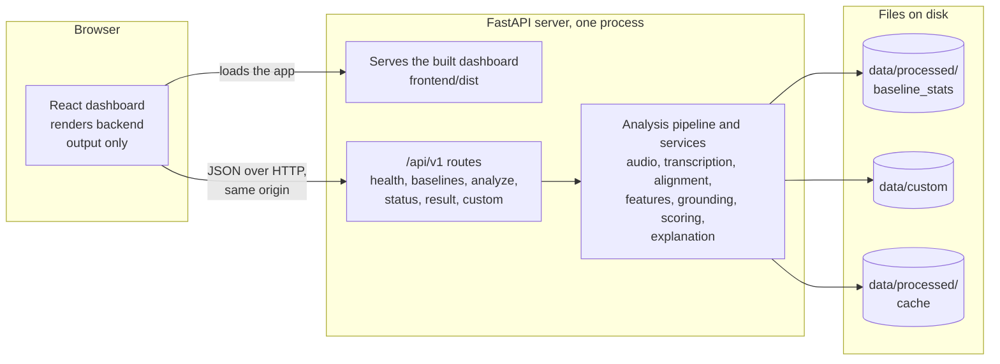
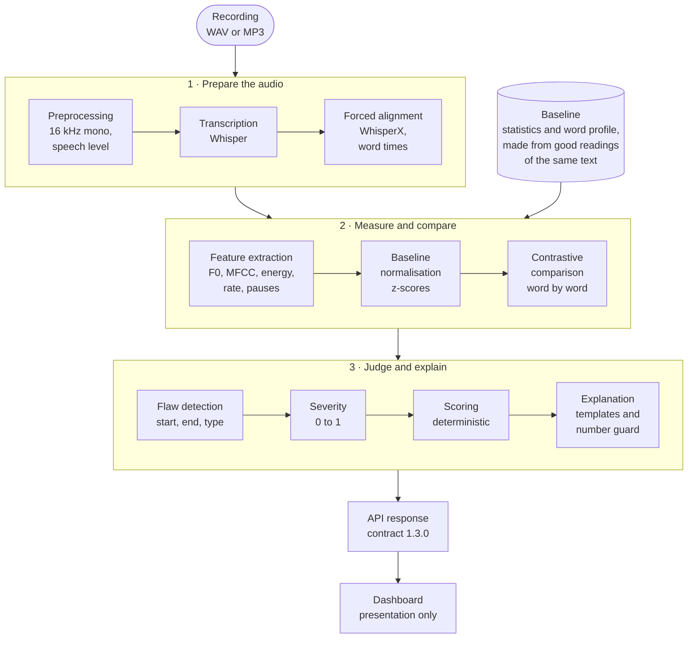

# VAANI: Technical Report

**Contrastive speech analytics with temporal flaw grounding**
IIT Mandi Multimodal AI Hackathon 2026, Track C

---

## 1. Abstract

VAANI compares a participant's spoken delivery of a passage with an *effective reading of the same passage* and reports where the delivery differs, by how much, and why that matters. Each finding is tied to a time interval on word boundaries, to the measurements that support it, and to a recommendation. The complete chain is

```
timestamp → measured evidence → flaw type → explanation → recommendation
```

The system is a single integrated product: a deterministic FastAPI backend that performs preprocessing, transcription, forced alignment, acoustic feature extraction, baseline-relative comparison, flaw detection, severity estimation, scoring and evidence-backed explanation, and a React dashboard that presents the result. All numerical analysis is deterministic code. No large language model (LLM) is used at any point, and an independent guard ensures that every number in an explanation originates from the analysis.

This report describes the problem, the architecture, each processing stage, the API, the dashboard, the engineering practices that keep results reproducible, and the technology used.

## 2. Problem and objectives

VAANI evaluates **delivery**, not the factual correctness or literary quality of speech. For any recording it answers six questions:

| # | Question | Where the answer comes from |
|---|---|---|
| 1 | Where did the delivery deviate from the effective baseline? | Word-by-word comparison with the baseline |
| 2 | Which measurable acoustic behaviour changed? | Speech rate, pauses, loudness, pitch movement |
| 3 | How large was the deviation? | Evidence values in the signal's own units; severity (0–1) |
| 4 | When did it occur? | Start and end times on word boundaries |
| 5 | Why does it represent a delivery flaw? | Template explanation built from the evidence |
| 6 | What should the speaker do? | Recommendation built from the baseline's own values |

**Objectives**

- Contrastive analysis against a same-content baseline rather than a universal average.
- Precise temporal grounding of every finding.
- Centralised acoustic feature extraction (pitch, MFCC, energy, speech rate, pauses).
- Reproducible, explainable scoring.
- Actionable feedback expressed in measured terms.
- An interactive dashboard that makes the evidence inspectable.

## 3. Design principles

| Principle | Realisation |
|---|---|
| **Contrast, not an average** | The baseline is built from good readings of the same text and keeps per-word expectations. |
| **Temporal grounding** | A finding always has a start and an end; pace and loudness findings start and end on word boundaries. |
| **Evidence before explanation** | The explanation layer consumes structured evidence; nothing is explained without a measurement. |
| **Deterministic numerics** | Feature extraction, normalisation, comparison, detection, severity and scoring contain no randomness. |
| **LLM boundary** | An LLM may only phrase already-computed evidence. In the delivered system none is used. |
| **Single source of truth** | Each concept has one implementation (features, grounding, scoring, schemas); the frontend consumes the backend output. |
| **Backend owns the truth** | The dashboard computes no pitch, rate, pause metric, severity or score. |
| **Explicit configuration** | Every analysis parameter is a named setting with a documented default. |

## 4. System architecture



The API serves the built dashboard at `/` and itself under `/api/v1`, so the product is one process on one origin. State is held in JSON files (baseline statistics, custom passages, the result cache); no database is required.

| Component | Location | Responsibility |
|---|---|---|
| API routes | `backend/app/api/` | Input validation, error mapping, orchestration entry points |
| Schemas | `backend/app/schemas/` | The typed API contract (Pydantic v2) |
| Core | `backend/app/core/` | Settings, baseline records, passage catalogue, result cache |
| Services | `backend/app/services/` | Audio, transcription, alignment, features, grounding, scoring, explanation, pipeline orchestration, baseline builder, custom passages |
| Dashboard | `frontend/` | Presentation, interaction, visualisation, playback |
| Scripts | `scripts/` | Environment check, OpenAPI export, demo-sample builder, dataset kit |

## 5. Processing pipeline



### 5.1 Preprocessing (`services/audio/`)

- Decodes WAV (PCM or float) and MP3 (via PyAV; no ffmpeg installation is required).
- Mixes multi-channel audio to mono and resamples to 16 kHz with a deterministic polyphase filter.
- Trims leading and trailing silence with an energy voice-activity detector and records the trim offset and original duration, so every timestamp in the result refers to the **uploaded file's own timeline**.
- Scales the recording so the median loudness of its speaking frames sits at −26 dBFS (peak capped at −1 dBFS), so recordings made at different input gains are comparable.
- Computes a SHA-256 over the processed samples for provenance.
- Accepts uploads up to 10 MB and 5 minutes.

### 5.2 Transcription (`services/transcription/`)

OpenAI Whisper (`base` model, English by default) converts speech to text. A `manual_transcript` can be supplied instead. Models are loaded on first use and then reused.

### 5.3 Forced alignment (`services/alignment/`)

WhisperX aligns the transcript to the audio, giving every word a start and an end time. A validator checks the alignment for plausibility before it is used.

### 5.4 Feature extraction (`services/features/`)

All frame-based features share a 10 ms hop so they can be overlaid on one time axis.

| Feature | Method |
|---|---|
| **Pitch (F0)** | Probabilistic YIN (`librosa.pyin`), 75–500 Hz, voiced frames only |
| **MFCC** | 13 coefficients, 10 ms hop |
| **Energy** | RMS in dBFS per frame |
| **Speech rate** | Words per minute over rolling 8 s windows every 4 s, from aligned word times |
| **Pauses** | Energy voice-activity detection combined with gaps between aligned words; each pause is classified as inside a sentence or between sentences |

Each feature has exactly one implementation; the dashboard and the dataset tools reuse the backend's output.

### 5.5 Baseline normalisation (`services/grounding/normalizer.py`)

Participant measurements are expressed relative to the baseline's statistics as z-scores, so a deviation is always measured against how the reference readers behaved and not against an absolute scale.

### 5.6 Contrastive comparison (`services/grounding/profile*.py`)

See section 6.

### 5.7 Flaw detection and temporal grounding (`services/grounding/candidates.py`, `flaws.py`)

Deviations become candidate findings with a start, an end and a type; neighbouring candidates of the same type are merged, and intervals are clipped to the audio.

### 5.8 Severity, scoring and explanation

See sections 7 and 8.

### 5.9 Orchestration (`services/pipeline.py`)

The pipeline runs the stages in order, attaches typed evidence to each finding, assembles the `AnalysisResult`, and stores it in the cache. Analysis is synchronous and serialised through a lock, so the shared speech models are used by one request at a time.

## 6. Baseline and word-by-word comparison

A single average pace for a whole passage cannot distinguish a rushed sentence from a sentence made of short words. VAANI therefore builds the baseline at **word level**.

**Baseline contents**

- Overall statistics: speech rate, pause durations (inside and between sentences), loudness, pitch.
- A **word profile**: for every word of the passage, how long it took, how loud it was and how much the pitch moved on it in each good reading, together with how much those readings vary.
- Provenance: dataset version, SHA-256, number of reference recordings.

**Comparison**

- A participant's reading is compared word by word with the profile after its own overall pace and level have been taken out, so a finding describes a *local* deviation.
- A reading that differs as a whole (for example fast, slow, loud, quiet or monotone throughout) is reported as a single finding covering the whole reading.
- Pauses are judged against the baseline's pauses at the same kind of place.
- With two reference readings the system uses overall averages; with three or more it uses the full word profile. The result's `notes` state which was used.

Baselines come from two sources: the dataset kit (`scripts/dataset/build_baseline_stats.py`, `prepare_recordings.py`) and **custom passages** (section 11), both using the same builder (`services/baseline_builder.py`).

## 7. Flaw vocabulary, severity and scoring

### 7.1 Flaw types

| Type | Meaning | Evidence carried by the finding |
|---|---|---|
| `too_fast` | A run of words spoken faster than the baseline readers spoke them | Rate, baseline rate and spread, difference in words/min and %, z-score, word count |
| `too_slow` | The same, slower | Same fields |
| `excessive_pause` | A pause much longer than the baseline's pauses at that kind of place | Pause length, baseline mean and spread, difference in seconds, z-score, position (inside or between sentences) |
| `low_energy` | Words spoken quieter than the baseline readers spoke them | Level, baseline level and spread, difference in dB, z-score |
| `high_energy` | The same, louder | Same fields |
| `flat_pitch` | Clearly less pitch movement than the baseline readers had on the same words | Movement in Hz against the baseline's, z-score, voiced share, the words |

Every finding also carries `start_s`, `end_s`, `duration_s`, `severity`, the affected words, an explanation, a recommendation and the method that produced the explanation.

### 7.2 Severity (`services/grounding/severity.py`)

Severity is a deterministic number in [0, 1]. It combines the **size** of the change (expressed against a documented "most serious" size for that flaw type) with **how long** the deviation lasted. A pause's severity depends on its excess length. Because severity is based on the measured size of the change, two findings with similar statistical significance but different practical size receive different severities.

### 7.3 Scoring (`services/scoring/`)

Each finding costs its dimension `30 × severity` points. Each of the four dimensions starts at 100; the composite score is the weighted sum:

| Dimension | Weight |
|---|---|
| Speech rate | 30 % |
| Pitch | 25 % |
| Pauses | 25 % |
| Energy | 20 % |

A dimension that could not be judged is left out and the remaining weights are renormalised. **100 means no deviation was detected.**

**Worked example: the *Mixed flaws* demo** (three findings)

| Dimension | Findings | Penalty | Score | Weight |
|---|---|---|---|---|
| Speech rate | 1 (too fast, severity 0.5343) | 30 × 0.5343 = 16.03 | 83.97 | 30 % |
| Pitch | 0 | 0 | 100.00 | 25 % |
| Pauses | 1 | 22.58 | 77.42 | 25 % |
| Energy | 1 | 25.04 | 74.96 | 20 % |

`0.30 × 83.97 + 0.25 × 100.00 + 0.25 × 77.42 + 0.20 × 74.96 = 84.54`

The scores, weights, penalties and finding counts are all returned in the result, so the score can be reproduced by hand from the response.

## 8. Evidence-backed explanation

Each explanation and recommendation is a **template filled from the finding's structured evidence** (`services/explanation/`). The pieces are:

| Module | Role |
|---|---|
| `facts.py` | Builds the *fact sheet*: pre-formatted values taken from the evidence |
| `templates.py` | Per-flaw-type explanation and recommendation templates |
| `guard.py` | Independent number-grounding guard |
| `summary.py` | The overall readout |

The guard checks that every numeric token in an explanation equals a value in the fact sheet and rejects spelled-out quantities (for example "twice" or "half") that could introduce an unmeasured ratio. Quoted transcript words are exempt only when they are exactly the words the finding covers. The guard is independent of whoever wrote the text, which means a future text generator could be added without weakening the guarantee that every figure the user reads was measured.

**Example finding** (from the *Mixed flaws* demo, shortened):

```jsonc
{
  "flaw_id": "flaw_001",
  "type": "too_fast",
  "start_s": 5.3996,
  "end_s": 9.0548,
  "severity": 0.5343,
  "evidence": {
    "rate_participant_wpm": 276.9105,
    "rate_baseline_mean_wpm": 166.8481,
    "rate_delta_pct": 65.9657,
    "rate_z_score": 18.1808,
    "word_count_in_window": 17
  },
  "explanation": "5.4–9.1 s: speech rate averaged 276.9 words/min, 66.0% above the 166.8 words/min the baseline readings had for these same words (18.18 standard deviations above it), covering “Over” to “they”. …",
  "recommendation": "Slow down in this stretch: aim for about 166.8 words/min, the pace the baseline readings had for these words, and keep the pauses between phrases.",
  "explanation_method": "template"
}
```

## 9. Reproducibility

- **Deterministic analysis.** Same audio, baseline and configuration give the same findings, scores and explanations.
- **Deterministic identity.** `analysis_id` is a version-5 UUID derived from a SHA-256 over the canonical JSON of everything the result depends on: the processed audio and its trim offset, the baseline identity and hash, the passage, any manual transcript, the configuration, pipeline and API versions, a fingerprint of every analytical constant, and the library versions.
- **Cache.** Results are stored as `<analysis_id>.json`, written atomically (temporary file and rename). A missing or invalid file is a cache miss, never an error. Identifiers are validated so an id can never address a file outside the cache directory.
- **No stale results.** Any change to a setting or library version produces a new id.
- **Provenance in every response.** `audio.sha256`, `baseline.sha256`, `config_version`, `config_fingerprint`, `pipeline_version`, `scoring_version` and `processing_meta` accompany the result.

## 10. API

Base path `/api/v1`; interactive documentation at `/docs`; schema at `/openapi.json`. Contract version **1.3.0** (`docs/architecture/api-contract.md`).

| Endpoint | Purpose |
|---|---|
| `GET /health` | Service, configuration, pipeline and contract versions |
| `GET /baselines` | Baselines available for analysis, with their passage text |
| `POST /analyze` | Multipart upload of `participant_audio` with `baseline_id` and `passage_id`; returns the `AnalysisResult` |
| `GET /status/{analysis_id}` | `done` or `not_found` |
| `GET /result/{analysis_id}` | The stored result |
| `POST /custom/baselines` | Make a baseline from the user's own passage and recordings |
| `DELETE /custom/baselines/{baseline_id}` | Remove a custom baseline |

**Result structure.** `api_contract_version`, `analysis_id`, `config_version`, `pipeline_version`, `audio`, `baseline`, `alignment_method`, `transcript`, `alignment`, `features`, `baseline_stats`, `flaws`, `scores`, `overall_summary`, `processing_meta`, `notes`, `config_fingerprint`.

**Errors** share one shape, `{"error": "<CODE>", "detail": "…", "analysis_id": null}`, with stable codes: `VALIDATION_ERROR` (422), `UNSUPPORTED_AUDIO_FORMAT`, `FILE_TOO_LARGE`, `AUDIO_TOO_LONG`, `CONFIG_VERSION_MISMATCH` (400), `BASELINE_NOT_FOUND`, `RESULT_NOT_FOUND` (404) and `PROCESSING_ERROR` (500).

**Contract discipline.** The dashboard's TypeScript types are generated from the API's own OpenAPI document. A backend test fails if the committed snapshot (`frontend/openapi.json`) differs from the live API, so the contract and its consumers cannot drift apart silently.

## 11. Custom passages

A user can bring their own text. They paste a passage, add two to six recordings of a good reading, and VAANI builds a baseline from them with the same builder used for the dataset. Each recording is aligned to the text and checked to confirm that it reads the passage. The baseline is stored under a deterministic `custom-…` id; the same text and recordings always give the same id. The user then analyses their own reading against it. Only statistics and text are stored; the audio is never kept.

## 12. Dashboard

### 12.1 Stack and structure

React 19 with TypeScript 5.9 and Vite 7. Routing is hash-based; application state lives in small external stores (analysis, player, history, connection, UI). Charts are hand-built SVG, so there is no chart or UI library dependency. Fonts (IBM Plex Sans and Mono, Newsreader) are self-hosted through Fontsource.

### 12.2 Views

| View | Content |
|---|---|
| **Home** | Landing page with a live instrument that draws the real analysis of a demo recording; hover reads any moment, click plays a finding |
| **New analysis** | Upload or record in the browser, choose a baseline, analyse |
| **Custom passage** | Make a baseline from your own text and recordings, then analyse your reading |
| **Overview** | Score, score-profile radar, plain-language readout |
| **Timeline** | Findings, words, loudness, pitch, speech rate and pauses on one zoomable time axis linked to playback |
| **Flaws** | Each finding with interval, severity, words, evidence against the baseline, explanation and recommendation; CSV export |
| **Signals** | Speech rate, loudness, pitch, every pause, MFCC summary |
| **Transcript** | Words with timing, the pauses between them and the findings that cover them |
| **Baseline and method** | The baseline used and how the comparison works |
| **Report** | Printable report |
| **Library, Settings, Help** | Demo samples and past analyses, appearance and timeline options, shortcuts and answers |

Further interaction: a command palette (`Ctrl+K`), keyboard shortcuts for navigation, playback and timeline control, JSON and CSV export, and link copying.

### 12.3 Boundary

The dashboard reads values from the `AnalysisResult` and does not derive analytics. It may look values up (the frame nearest a time, the word being spoken), order and format them, and thin a long series for drawing while keeping each pixel column's extremes so peaks never disappear. Page tests compare the numbers on screen with the numbers in the result. `docs/architecture/frontend.md` maps every figure on screen to the field it comes from.

### 12.4 In-browser recording

"Record now" captures raw samples with the browser's voice processing requested off, resamples them to 16 kHz mono with a deterministic converter, encodes a 16-bit PCM WAV and hands it to the upload form. Level and clipping indicators help the speaker; they are capture aids and play no part in the analysis.

### 12.5 Design system

The VAANI visual identity uses one token-based system across every page: obsidian (`#0B0F12`) and graphite (`#141B20`) surfaces, ivory (`#F4F0E8`) type, **cyan (`#70D6FF`) for signal and interaction, copper (`#F28C5B`) for deviation, steel (`#82919B`) for the reference**. Dark is the default; light and system themes are available. The home page instrument, the radar and the timeline traces animate only with purpose and respect reduced-motion and coarse-pointer settings. The printable report is paper-white in either theme.

### 12.6 Accessibility and responsiveness

- axe-core audit of 70 page and state combinations in both themes with no violations.
- Layout audit of 12 pages at eight widths from 320 to 2560 px in both themes with no horizontal overflow.
- Keyboard operation throughout, focus management for dialogs and the navigation drawer, and a text list beside the radar carrying the same numbers.

## 13. Dataset and tooling

The dataset kit supports recording and registering speech for baselines (`scripts/dataset/`):

| Tool | Purpose |
|---|---|
| `make_plan.py` | Deterministic recording plan and an on-screen prompter page per speaker |
| `check_recordings.py` | Quality gates: format, level, clipping, room noise, silence at the ends, length, hum |
| `prepare_recordings.py` | Registers takes: copies, hashes, preprocesses, aligns with WhisperX, proposes annotations, writes Audacity label files, builds the baseline |
| `build_baseline_stats.py` | Builds baseline statistics for a passage |
| `evaluate_takes.py` | Replays registered takes through the analysis and compares findings with annotations |
| `validate_dataset.py` | Checks dataset metadata |
| `check_environment.py` | Verifies a computer has what the project needs and downloads the speech models once |

Documentation for the kit: `docs/methodology/dataset-guide.md` (plain-language guide), `recording-protocol.md`, `dataset-schema.md` and a consent-form template.

## 14. Quality engineering

| Layer | Practice |
|---|---|
| **Backend and integration** | 1389 pytest tests: normal input, edge cases, invalid input and repeated-run determinism for audio, features, baseline, detection, severity, scoring, explanation, API, cache and the dataset tools |
| **Dashboard** | 386 Vitest tests (components, charts, stores, flows) |
| **Accessibility** | axe-core over 70 page and state combinations |
| **End to end** | 42 browser checks in Chromium driving the running app, including a recording from a fake microphone |
| **Contract** | OpenAPI snapshot drift test; generated TypeScript types |
| **Mutation checks** | Deliberately injected bugs in several modules (recorder, registration tool, custom passages, landing instrument) to confirm the tests detect them |
| **Real-model tests** | `pytest -m smoke` runs the real Whisper and WhisperX models |

The suites are run with `python -m pytest` and, from `frontend/`, `npm test`, `npm run a11y` and `npm run smoke`.

## 15. Security and privacy

- **Input validation.** Presence, extension, size, content type and `config_version` are validated; client filenames are sanitised; identifiers match a strict pattern.
- **Safe errors.** Unexpected failures return a generic `PROCESSING_ERROR`; details go to the log and never to the client, and responses never contain server paths.
- **Confined storage.** Result and baseline identifiers are validated so they cannot address files outside their folders.
- **CORS** is limited to a configured list of origins; the normal deployment is one origin.
- **No secrets in the repository.** Settings come from environment variables; `.env.example` lists names only.
- **Local processing.** Audio is analysed by the local server and is not kept; only results (JSON) and custom-passage statistics and text are stored. The dashboard makes requests only to its own server, with fonts bundled and no analytics.
- **Recordings of people** are excluded from version control; a consent form template is provided.

## 16. Technology stack

| Layer | Technology |
|---|---|
| API | Python 3.10–3.13, FastAPI, Uvicorn, Pydantic v2, python-multipart, python-dotenv |
| Audio | PyAV, NumPy, SciPy |
| Acoustic features | librosa (pYIN F0, MFCC, RMS) |
| Speech models | OpenAI Whisper, WhisperX (with PyTorch) |
| Dashboard | React 19, TypeScript 5.9, Vite 7, hand-built SVG charts |
| Testing | pytest; Vitest, Testing Library, jsdom; axe-core; Playwright (Chromium) |
| Types | openapi-typescript, generated from the API's OpenAPI document |
| Storage | JSON files; no database |

No Docker, ffmpeg installation, external LLM or API key is required.

## 17. Running the system

```bash
git clone https://github.com/rubella2121/speechdummy.git
cd speechdummy

# Full application: API and dashboard on one address
python -m venv .venv && source .venv/bin/activate        # PowerShell: .\.venv\Scripts\Activate.ps1
python -m pip install -r requirements.txt
(cd frontend && npm ci && npm run build)
python -m uvicorn app.main:app --app-dir backend         # open http://127.0.0.1:8000/
```

The four demo analyses also open from the dashboard alone (`cd frontend && npm ci && npm run dev`). Full instructions, including Windows PowerShell, are in the [README](../README.md) and `docs/setup.md`.

## 18. Roadmap

- Detection of pitch instability and reduced vocal clarity (the corresponding taxonomy entries are defined).
- Coaching text phrased by an LLM that receives only the measured fact sheet and must pass the same number guard.
- Additional speakers and passages in the dataset kit.

## 19. References

- Mauch, M., & Dixon, S. (2014). *pYIN: A fundamental frequency estimator using probabilistic threshold distributions.* ICASSP.
- Radford, A., et al. (2022). *Robust Speech Recognition via Large-Scale Weak Supervision* (Whisper).
- Bain, M., et al. (2023). *WhisperX: Time-Accurate Speech Transcription of Long-Form Audio.*
- McFee, B., et al. *librosa: Audio and Music Signal Analysis in Python.*

## Appendix A. Documentation map

| Document | Content |
|---|---|
| [`README.md`](../README.md) | Overview, quick start, API summary |
| [`ARCHITECTURE.md`](../ARCHITECTURE.md) | Canonical design |
| [`DECISIONS.md`](../DECISIONS.md) | Design decisions with their reasons |
| [`docs/architecture/api-contract.md`](architecture/api-contract.md) | API contract |
| [`docs/architecture/frontend.md`](architecture/frontend.md) | Dashboard architecture |
| [`docs/setup.md`](setup.md) | Environment setup |
| [`docs/methodology/dataset-guide.md`](methodology/dataset-guide.md) | Dataset guide |
